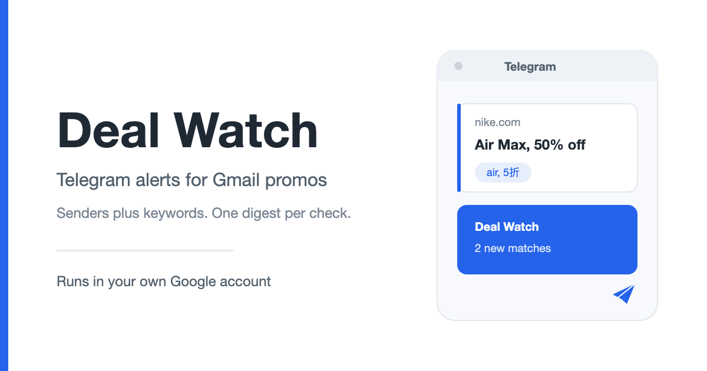

# Deal Watch

Get a Telegram message when a promotion email that matches your keywords lands in your Gmail inbox.

Everything runs inside your own Google account. No server, no database, no third-party service, and no shared bot: you deploy your own copy, so your keys stay yours.

## What it does

- **Watch chosen senders** — a whole domain (`xxx.com`) or one address (`abc@xxx.com`).
- **Match your keywords** — comma-separated keywords work as OR; wrap a phrase in `"quotes"` to match it exactly.
- **One digest per check** — matches grouped per thread with subject, date, and a link. Nothing found means no message.
- **Button-first Telegram** — add rules, change the check interval, and read status by tapping buttons.
- **Optional keyword ideas** — with an OpenRouter key, a Mini App suggests keywords for a topic you type. It never reads your email.

## Get started

1. Create a bot in BotFather and copy its token.
2. Copy the Sheet template and deploy the Web App.
3. Run **Deal Watch > Setup**, paste the token and `/exec` URL, then open the bind link in Telegram.

**[Setup guide](https://carmenchancky.github.io/deal-watch/setup.html)** · **[Open the template](https://docs.google.com/spreadsheets/d/1pNb1TCxCix7ublIMJN-R3xNJn_6sjlU_rzRanuQFDno/edit?usp=sharing)** (then **File > Make a copy**).

## Documentation

- [Setup](https://carmenchancky.github.io/deal-watch/setup.html)
- [Usage](https://carmenchancky.github.io/deal-watch/usage.html)
- [FAQ](https://carmenchancky.github.io/deal-watch/faq.html)
- [Changelog](CHANGELOG.md)

## Updates

Deal Watch never updates itself: each copy is yours alone. When a newer release exists, `/status` and the next digest flag it, and you replace the code by hand — see [Updating](https://carmenchancky.github.io/deal-watch/usage.html#updating). Watch this repository's **Releases** to be notified.

## How it works

- **Stack:** Google Apps Script bound to a Google Sheet (`GmailApp`, `SpreadsheetApp`, `PropertiesService`, `CacheService`, `UrlFetchApp`). No server, no database.
- **Flow:** Telegram ↔ Apps Script ↔ hidden Sheet ↔ Gmail → Telegram Bot API → your phone.
- **Layout:** `src/` (the Apps Script), `docs/` (static site), `test/` (acceptance plans), `version.txt` + `CHANGELOG.md` (releases).

## Contributing

Issues and pull requests are welcome.

## License

MIT — see [LICENSE](LICENSE). © 2026 Carmen Chan.
